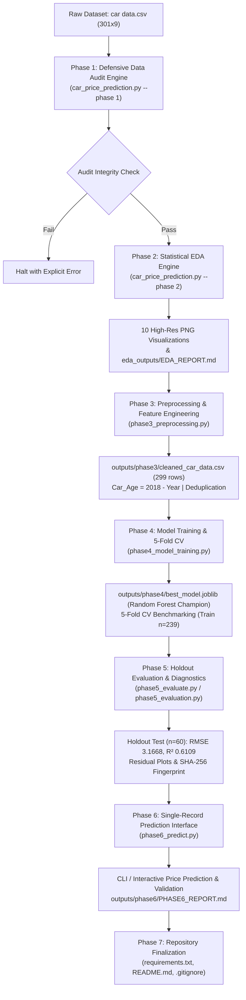

# Product Requirement Document (PRD)
## Project: Car Price Prediction & Resale Valuation Engine
**Project Identifier:** CodeAlpha Data Science Internship — Task 3  
**Document Version:** 1.1.0  
**Status:** Verified & Finalized (Phases 1–6 Completed & Verified; Phase 7 Documentation & Submission Completed)  
**Target Systems:** Windows / Linux / macOS (Python 3.9–3.13)  
**Primary Deliverables:**
- Phase 1 & 2: [`car_price_prediction.py`](file:///c:/CHATBOT/Car%20Price%20Prediction%20Model/car_price_prediction.py)
- Phase 3: [`phase3_preprocessing.py`](file:///c:/CHATBOT/Car%20Price%20Prediction%20Model/phase3_preprocessing.py)
- Phase 4: [`phase4_model_training.py`](file:///c:/CHATBOT/Car%20Price%20Prediction%20Model/phase4_model_training.py)
- Phase 5: [`phase5_evaluate.py`](file:///c:/CHATBOT/Car%20Price%20Prediction%20Model/phase5_evaluate.py) / [`phase5_evaluation.py`](file:///c:/CHATBOT/Car%20Price%20Prediction%20Model/phase5_evaluation.py)
- Phase 6: [`phase6_predict.py`](file:///c:/CHATBOT/Car%20Price%20Prediction%20Model/phase6_predict.py)
- Phase 7: [`README.md`](file:///c:/CHATBOT/Car%20Price%20Prediction%20Model/README.md), [`requirements.txt`](file:///c:/CHATBOT/Car%20Price%20Prediction%20Model/requirements.txt), [`.gitignore`](file:///c:/CHATBOT/Car%20Price%20Prediction%20Model/.gitignore)

---

## 1. Executive Summary & Objective

### 1.1 Purpose
The purpose of this project is to develop an end-to-end, defensibly audited, statistically sound machine learning pipeline for used car resale valuation. The system takes tabular used car listing records and produces empirical data audits, deep exploratory analysis, and trained regression models that estimate fair market resale prices (`Selling_Price`).

### 1.2 Core Philosophy
- **Defensive Data Ingestion**: No silent drops, implicit imputation, or unhandled data corruptions.
- **Statistical Rigor**: Dynamic computation from runtime data; clear separation of correlation vs. causation; acknowledgment of segment confounding.
- **Unit Neutrality**: Strict usage of "dataset price units" unless currency/scale is explicitly documented in the dataset metadata.
- **Anti-Leakage Pipeline Architecture**: Strict encapsulation of preprocessing within training folds and holdout data isolation via Scikit-Learn pipelines.
- **Viva-Ready Architecture**: Code structure, logs, and artifacts are designed for academic and technical internship evaluation.

---

## 2. Dataset Contract & Data Schema

### 2.1 Raw Dataset Specification
- **Primary Source File:** `car data.csv` / `car data(1).csv`
- **Expected Dimensions:** 301 Rows × 9 Columns (299 unique records after deduplication)
- **Price Unit Policy:** Documented neutrally as **"dataset price units"** (do NOT assume INR or lakhs without metadata proof).

### 2.2 Feature Dictionary & Constraints

| Column Name | Physical Type | Logical Role | Constraints & Permissible Values |
| :--- | :--- | :--- | :--- |
| `Car_Name` | String / Object | Identifier / Model | Non-empty string. 98 unique values. High-cardinality; excluded from baseline modeling predictors. |
| `Year` | Integer | Temporal Feature | Range: $2003 \le \text{Year} \le 2018$. Historical reference year: 2018. |
| `Selling_Price` | Float | **Target Variable ($Y$)** | Strictly positive ($> 0.0$). Continuous. Expected range: $[0.10, 35.00]$. |
| `Present_Price` | Float | Feature ($X$) | Showroom asset value ($> 0.0$). Continuous. Expected range: $[0.32, 92.60]$. |
| `Driven_kms` | Integer / Float | Feature ($X$) | Odometer reading ($\ge 0$). Expected range: $[500, 500000]$. |
| `Fuel_Type` | Categorical / String | Feature ($X$) | Permissible set: `{'Petrol', 'Diesel', 'CNG'}`. Case-insensitive normalization. |
| `Selling_type` | Categorical / String | Feature ($X$) | Permissible set: `{'Dealer', 'Individual'}`. |
| `Transmission` | Categorical / String | Feature ($X$) | Permissible set: `{'Manual', 'Automatic'}`. |
| `Owner` | Integer | Feature ($X$) | Number of previous owners. Observed set: $\{0, 1, 3\}$. Treated as numeric. |

---

## 3. High-Level System Architecture



---

## 4. Functional Requirements (FR)

### Module 1: Defensive Ingestion & Dataset Audit (Phase 1)
- **FR-1.1: Multi-Token Pseudo-Missing Detection**:
  Treat genuine empty values as Category A missing, and explicit string tokens (`'NA'`, `'null'`, `'none'`, `'nan'`, `'?'`, `'n/a'`, `'missing'`) as Category B pseudo-missing tokens.
- **FR-1.2: Schema & Column Validation**:
  Enforce presence of all 9 required columns. Fail immediately if mandatory columns are missing.
- **FR-1.3: Type & Range Boundary Checks**:
  Verify positive numeric ranges (`Selling_Price > 0`, `Present_Price > 0`, `Driven_kms >= 0`). Flag violations with row indices.
- **FR-1.4: Infinite & Non-Numeric Value Trapping**:
  Reject or flag `+/-inf`, non-parseable numeric values, and negative prices.
- **FR-1.5: String Sanitization Auditing**:
  Detect leading/trailing whitespace without silent modification during the audit phase.
- **FR-1.6: Duplicate Detection**:
  Identify duplicate listings across all attributes. Report row indices and preserve data integrity during audit.
- **FR-1.7: Overall Audit Health Classification**:
  Output overall health state: `PASS`, `PASS WITH WARNINGS`, or `FAIL`.

### Module 2: Exploratory Data Analysis & Statistical Inference (Phase 2)
- **FR-2.1: Univariate Distribution Analysis**:
  Calculate mean, median, standard deviation, IQR, skewness, and kurtosis dynamically for numerical attributes.
- **FR-2.2: Bivariate Relationship Analysis**:
  Calculate both Pearson linear correlation ($r$) and Spearman rank correlation ($\rho$). Document segment confounding.
- **FR-2.3: Inferential Hypothesis Testing**:
  - Run Shapiro-Wilk normality tests on continuous distributions.
  - Run Mann-Whitney U rank-sum tests for binary categorical groups (`Diesel` vs `Petrol`, `Automatic` vs `Manual`).
  - Run Kruskal-Wallis H-test for multi-group comparisons (`Fuel_Type`).
- **FR-2.4: Outlier & Anomaly Logging**:
  Compute Tukey IQR fences ($Q1 - 1.5 \times IQR$ and $Q3 + 1.5 \times IQR$). Differentiate statistical outliers from physical recording errors.
- **FR-2.5: Automated Report & Chart Generation**:
  Export 10 PNG charts and a formatted `EDA_REPORT.md` into the designated `--output-dir`.

### Module 3: Preprocessing & Feature Engineering (Phase 3)
- **FR-3.1: Deduplication**:
  Remove 2 exact duplicate records to yield a 299-row modeling dataset, serialized to `outputs/phase3/cleaned_car_data.csv`.
- **FR-3.2: Temporal Feature Engineering**:
  Compute vehicle age using the historical dataset reference year 2018: $\text{Car\_Age} = 2018 - \text{Year}$.
- **FR-3.3: High-Cardinality Feature Handling**:
  Exclude `Car_Name` (98 unique names) from baseline modeling predictors to prevent severe dimensionality explosion and overfitting; `Present_Price` serves as continuous vehicle tier and asset proxy.
- **FR-3.4: Numerical & Categorical Treatment**:
  - Retain `Owner` as an integer numerical feature ($\{0, 1, 3\}$), scaled alongside `Present_Price`, `Driven_kms`, and `Car_Age` via `StandardScaler`.
  - Encode categorical predictors (`Fuel_Type`, `Selling_type`, `Transmission`) via `OneHotEncoder(drop='first', sparse_output=False, handle_unknown='ignore')`.
- **FR-3.5: Anti-Leakage Pipeline Blueprint**:
  Assemble Scikit-Learn `ColumnTransformer` and pipeline blueprints without fitting on full data, ensuring zero data leakage into validation folds.

### Module 4: Model Training & Cross-Validation Benchmarking (Phase 4)
- **FR-4.1: Deterministic Split**:
  Partition dataset into 80% train ($n=239$) and 20% holdout test ($n=60$) using `random_state=42`.
- **FR-4.2: 5-Fold Cross-Validation on Training Split**:
  Benchmark 5 candidate regression architectures strictly within the training split:
  - Linear Regression (RMSE: 1.6479, MAE: 1.1035, $R^2$: 0.8846)
  - Ridge Regression (RMSE: 1.6412, MAE: 1.1025, $R^2$: 0.8854)
  - Decision Tree (RMSE: 1.9310, MAE: 0.8825, $R^2$: 0.8446)
  - Random Forest (RMSE: 1.5766, MAE: 0.7352, $R^2$: 0.8926) — **Selected Champion**
  - Gradient Boosting (RMSE: 1.6370, MAE: 0.8730, $R^2$: 0.8840)
- **FR-4.3: Model Selection & Artifact Serialization**:
  Refit selected champion (Random Forest) on the full 239-row training set and serialize pipeline to `outputs/phase4/best_model.joblib`.

### Module 5: Holdout Evaluation & Diagnostics (Phase 5)
- **FR-5.1: Zero-Leakage Holdout Pass**:
  Execute single forward inference pass on 60 reserved test records without retraining or tuning.
- **FR-5.2: Model Integrity Verification**:
  Verify SHA-256 fingerprint of loaded pipeline against Phase 4 metadata (`cd1d6160fba8288755b83a3b64e0ed3c3e33365705e4af615c92e27a11eccb3a`).
- **FR-5.3: Metric Computation**:
  Calculate holdout performance: RMSE = 3.1668, MAE = 1.3567, Median Absolute Error = 0.4081, $R^2 = 0.6109$.
- **FR-5.4: Generalization Gap Analysis**:
  Document CV RMSE (1.5766) vs Holdout RMSE (3.1668) gap as an empirical generalization variance indicator driven by high-leverage luxury cars, distinguishing explained variance from percentage accuracy.

### Module 6: Prediction Interface (Phase 6)
- **FR-6.1: Forward Inference CLI**:
  Provide standalone command-line and interactive inference via `phase6_predict.py` without retraining.
- **FR-6.2: Defensive Input Validation**:
  Validate numeric bounds, permitted categories, and non-negative values; verify pipeline estimator alignment against metadata.

### Module 7: Repository Finalization & Reviewer Readiness (Phase 7)
- **FR-7.1: Minimal Dependency Specification**:
  Pin verified direct runtime and test dependencies in `requirements.txt`.
- **FR-7.2: Repository Hygiene**:
  Configure comprehensive `.gitignore` and remove temporary IDE runner artifacts (`tempCodeRunnerFile.py`).
- **FR-7.3: Reviewer Documentation**:
  Provide comprehensive root `README.md` with methodology, benchmark tables, Mermaid architecture, and reproducible commands.

---

## 5. Non-Functional Requirements (NFR)

- **NFR-1 (Statistical Integrity):** Correlation values must never be presented as proof of causation. Weak linear correlation must not be claimed as lack of predictive value when segment confounding exists.
- **NFR-2 (Dynamic Statistical Computation):** Every statistic, count, percentage, test statistic, p-value, and table row must be dynamically calculated at runtime from the actual CSV data.
- **NFR-3 (Defensive Error Resilience):** Custom exception hierarchies (`CarPriceDataError`, `CarPriceValidationError`) must catch domain failures without using bare `except: pass`.
- **NFR-4 (Execution Performance & Portability):** End-to-end execution of all phases must complete on commodity hardware using standard Python environments (tested on Python 3.13.13).
- **NFR-5 (Headless Plotting):** Must support execution on headless servers and CI/CD pipelines via `matplotlib.use('Agg')`.

---

## 6. Edge-Case Matrix & Test Scenarios

The system is validated against critical edge cases and regression suites:
- **Phase 1 Audit Suite (`test_edge_cases.py`):** 11 edge cases validating schema rejections, empty files, pseudo-missing tokens, and boundary checks.
- **Phase 3 Preprocessing Suite (`test_phase3.py`):** 11 tests covering deduplication, whitespace normalization, feature engineering, and anti-leakage blueprint.
- **Phase 4 Training Suite (`test_phase4.py`):** 7 tests covering dataset partitioning, model candidate structure, and pipeline serialization.
- **Phase 5 Evaluation Suite (`test_phase5.py`):** 6 tests validating artifact integrity, holdout exactness, and defensive validation.
- **Phase 6 Prediction Suite (`test_phase6.py`):** 8 tests validating single-record inference, category validation, missing MedAE fallback, and estimator mismatch trapping.
- **Total Regression Suite:** 32 unit tests executed via `python -m unittest discover`.

---

## 7. Command Line Interface (CLI) Specification

```text
# Phase 1 & 2: Audit and Exploratory Data Analysis
python car_price_prediction.py --phase all --output-dir eda_outputs

# Phase 3: Data Preprocessing & Feature Engineering
python phase3_preprocessing.py

# Phase 4: Model Training & 5-Fold Cross-Validation
python phase4_model_training.py

# Phase 5: Holdout Evaluation & Diagnostics
python phase5_evaluate.py

# Phase 6: Single-Record Prediction
python phase6_predict.py --present-price 5.59 --driven-kms 27000 --car-age 4 --owner 0 --fuel-type Petrol --selling-type Dealer --transmission Manual

# Phase 7: Full Test Suite Execution
python -m unittest discover -v
```

---

## 8. Viva & Technical Review Defense Guide

### Q1: Why does `Driven_kms` show almost zero Pearson correlation with `Selling_Price` ($r = 0.029$)?
> **Answer:** Correlation measures bivariate linear association across the *pooled* sample. In this dataset, there is severe **segment confounding**: luxury SUVs (Fortuner, Innova) accumulate high mileage (30,000–50,000 km) while retaining high resale values, whereas low-mileage two-wheelers (Activa, Pulsar with <10,000 km) have low price ceilings. The true conditional effect of mileage is negative within any single vehicle tier.

### Q2: Target variable `Selling_Price` is heavily non-normal ($p < 0.001$). Does this invalidate linear regression?
> **Answer:** No. Ordinary Least Squares (OLS) does *not* require the dependent variable $Y$ to be normally distributed. It only assumes that the *errors/residuals* $\epsilon = Y - \hat{Y}$ are normally distributed and homoskedastic conditional on $X$. However, heavy right skewness ($+2.49$) means high-priced luxury cars exert large leverage, which motivates evaluating tree ensembles (Random Forest, Gradient Boosting).

### Q3: Why didn't you drop the 2 duplicate rows during Phase 1?
> **Answer:** An audit phase should be diagnostic and non-destructive. Modifying the raw data during an audit obscures data provenance. The 2 duplicates are logged as data leakage risks and removed in Phase 3 prior to train-test splitting.

### Q4: Why is holdout $R^2 = 0.6109$ lower than training CV $R^2 = 0.8926$?
> **Answer:** $R^2$ represents the proportion of target variance explained by the model relative to a mean baseline, not a percentage accuracy score. The test partition ($n=60$) contains high-leverage luxury vehicle listings where residual deviations are penalized heavily by squared error terms. The median absolute error of 0.4081 dataset price units confirms that over 50% of predictions are accurate within half a price unit.

---

## 9. Sign-off & Revision History

| Version | Date | Author | Notes |
| :--- | :--- | :--- | :--- |
| **1.0.0** | 2026-10-17 | Senior DS Reviewer / Intern | Phase 1 & 2 verified; initial PRD authored. |
| **1.1.0** | 2026-10-17 | Senior DS Reviewer / Intern | Synchronized PRD with actual 7-phase repository architecture. Updated architecture diagram, documented Phase 3–6 implementations (Owner as numeric [0, 1, 3], Car_Age ref 2018, Car_Name exclusion), qualified anti-leakage and statistical claims, and recorded Phase 7 finalization. |

