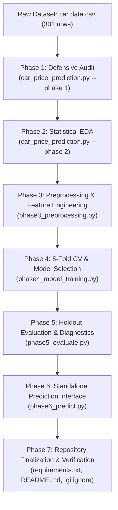

# Used Car Price Prediction & Resale Valuation Model

**CodeAlpha Data Science Internship — Task 3**  
**Author:** Data Science Intern / Candidate  
**Project Status:** Completed, Audited & Verified (Phases 1–7)  
**Target Environment:** Python 3.9–3.13 (Verified on Python 3.13.13, Windows x64)

---

## 1. Project Overview & Objective

The objective of this project is to develop an end-to-end, statistically defensible machine learning system to predict used car selling prices from listing attributes. Developed for **CodeAlpha Data Science Internship Task 3**, this repository demonstrates industry-grade engineering practices:
- **Defensive Data Ingestion & Audit:** Strict schema validation without silent drops or implicit imputation.
- **Statistical Exploratory Data Analysis (EDA):** Hypothesis testing (Shapiro-Wilk, Mann-Whitney U, Kruskal-Wallis) and segment confounding analysis.
- **Anti-Leakage Preprocessing:** Clean feature engineering and transformation pipelines encapsulated within cross-validation folds.
- **Rigorous Model Benchmarking:** 5-fold cross-validation across 5 linear and ensemble architectures.
- **Zero-Leakage Holdout Evaluation:** Evaluation on a strictly reserved 20% holdout split with SHA-256 model fingerprinting.
- **CLI & Interactive Inference:** Clean prediction interface with defensive domain validation.

---

## 2. Dataset Overview & Contract

The project models the classic Used Car dataset (`car data.csv` / `car data(1).csv`).

### 2.1 Dataset Summary
- **Raw Observations:** 301 rows × 9 columns
- **Duplicate Records Removed:** 2 exact duplicate listings removed during Phase 3 preprocessing
- **Final Modeling Dataset:** 299 rows × 10 columns (`outputs/phase3/cleaned_car_data.csv`)
- **Missing / Infinite Values:** 0 missing (NaN) and 0 infinite values across all fields
- **Unit Policy:** Documented strictly as **"dataset price units"**. The raw dataset header does not specify a currency code or unit multiplier; therefore, no currency (such as INR, Lakhs, or USD) is assumed.

### 2.2 Feature Dictionary

| Column Name | Type | Logical Role | Description & Permissible Range |
| :--- | :--- | :--- | :--- |
| `Car_Name` | String | Identifier | 98 unique models. Excluded from baseline predictors due to high cardinality; `Present_Price` acts as continuous vehicle tier proxy. |
| `Year` | Integer | Raw Feature | Manufacturing year ($2003 \le \text{Year} \le 2018$). Transformed to `Car_Age`. |
| `Car_Age` | Integer | Engineered Feature | Vehicle age computed as $\text{Car\_Age} = 2018 - \text{Year}$ ($0 \le \text{Car\_Age} \le 15$). Historical reference year: 2018. |
| `Present_Price`| Float | Predictor ($X$) | Original showroom / new vehicle price in dataset price units ($0.32 \le \text{Present\_Price} \le 92.60$). |
| `Driven_kms` | Float / Int | Predictor ($X$) | Odometer reading in kilometers ($500 \le \text{Driven\_kms} \le 500,000$). |
| `Fuel_Type` | Categorical | Predictor ($X$) | Fuel system: `Petrol`, `Diesel`, or `CNG`. |
| `Selling_type` | Categorical | Predictor ($X$) | Seller channel: `Dealer` or `Individual`. |
| `Transmission` | Categorical | Predictor ($X$) | Gearbox type: `Manual` or `Automatic`. |
| `Owner` | Integer | Predictor ($X$) | Number of previous owners ($\{0, 1, 3\}$). Retained as numeric. |
| `Selling_Price`| Float | **Target ($Y$)** | Final transaction / resale price in dataset price units ($0.10 \le \text{Selling\_Price} \le 35.00$). |

---

## 3. End-to-End System Workflow

The project is structured into seven decoupled, independently testable phases:



---

## 4. Preprocessing & Feature Engineering Methodology

1. **Deduplication:** 2 exact duplicate listings (`301 -> 299` records) removed prior to partitioning to prevent identical observations from leaking across training and validation sets.
2. **Temporal Transformation (`Car_Age`):** Because the dataset was collected historically up to 2018, vehicle age is formulated as:
   $$\text{Car\_Age} = 2018 - \text{Year}$$
   Using the historical reference year 2018 ensures age remains zero-bounded, physically meaningful, and reproducible.
3. **High-Cardinality Treatment (`Car_Name`):** With 98 unique vehicle names across 299 rows, one-hot encoding `Car_Name` would produce extreme dimensionality and severe overfitting. `Car_Name` is excluded from the baseline feature set; `Present_Price` serves as a continuous, high-fidelity proxy for vehicle tier and luxury status.
4. **Numerical Pipeline:** `['Present_Price', 'Driven_kms', 'Car_Age', 'Owner']` are scaled using `StandardScaler`.
5. **Categorical Pipeline:** `['Fuel_Type', 'Selling_type', 'Transmission']` are encoded via `OneHotEncoder(drop='first', sparse_output=False, handle_unknown='ignore')`.
6. **Encapsulation:** All transformers are encapsulated inside Scikit-Learn `ColumnTransformer` pipelines. Transformers are fitted exclusively on training folds, eliminating data leakage.

---

## 5. Model Selection & Cross-Validation Benchmarks (Phase 4)

Candidate models were benchmarked strictly on the 80% training partition ($n=239$) using **5-Fold Cross-Validation** (`random_state=42`, `shuffle=True`).

| Model Architecture | Mean CV RMSE (± Std) | Mean CV MAE (± Std) | Mean CV $R^2$ (± Std) | Selection Status |
| :--- | :--- | :--- | :--- | :--- |
| **Linear Regression** | 1.6479 (± 0.4904) | 1.1035 (± 0.2442) | 0.8846 (± 0.0322) | Baseline Linear |
| **Ridge Regression** | 1.6412 (± 0.4799) | 1.1025 (± 0.2449) | 0.8854 (± 0.0318) | Regularized Linear |
| **Decision Tree** | 1.9310 (± 1.0503) | 0.8825 (± 0.2038) | 0.8446 (± 0.0976) | Single Tree Baseline |
| **Random Forest** | **1.5766 (± 0.8708)** | **0.7352 (± 0.2123)** | **0.8926 (± 0.0716)** | **SELECTED CHAMPION** |
| **Gradient Boosting**| 1.6370 (± 1.1362) | 0.8730 (± 0.2407) | 0.8840 (± 0.1055) | Candidate Ensemble |

> **Champion Selection Decision:** **Random Forest Regressor** achieved the lowest Mean CV RMSE (1.5766 dataset price units) and lowest Mean CV MAE (0.7352 dataset price units). It was refitted on the full 239-row training set and frozen as `outputs/phase4/best_model.joblib`.

---

## 6. Holdout Test Evaluation & Statistical Diagnostics (Phase 5)

The frozen champion pipeline was evaluated on the 20% holdout test partition ($n=60$, `random_state=42`) without refitting or tuning.

### 6.1 Holdout Performance Metrics

| Evaluation Metric | Test Partition Score | Training 5-Fold CV Mean | Interpretation |
| :--- | :--- | :--- | :--- |
| **Root Mean Squared Error (RMSE)** | **3.1668** | 1.5766 | Standard deviation of residual errors; penalizes large outliers. |
| **Mean Absolute Error (MAE)** | **1.3567** | 0.7352 | Average absolute price deviation across all test cars. |
| **Median Absolute Error (MedAE)** | **0.4081** | N/A | Central tendency of error; robust to extreme luxury outliers. |
| **Coefficient of Determination ($R^2$)**| **0.6109** | 0.8926 | Proportion of target variance explained by the model. |

### 6.2 Key Statistical & Methodological Clarifications
1. **$R^2$ is Explained Variance, NOT Percentage Accuracy:**  
   $R^2 = 0.6109$ indicates that the model accounts for **61.09% of the total variance** in `Selling_Price` relative to predicting the test set mean. It is mathematically incorrect to interpret $R^2$ as "the model is 61% accurate".
2. **Analysis of the CV-to-Holdout Performance Gap:**  
   The gap between CV RMSE (1.5766) and Holdout RMSE (3.1668) highlights empirical generalization variance caused by the small sample size ($n=60$ test vehicles) containing high-leverage luxury cars (e.g., vehicles with showroom price $> 30$ dataset price units). In small samples, large residual errors on 2–3 luxury vehicles quadratically inflate the RMSE.
3. **Robust Central Accuracy (MedAE = 0.4081):**  
   While squared errors are inflated by high-leverage luxury listings, the **Median Absolute Error of 0.4081** demonstrates that for 50% of typical vehicles, the model's price prediction deviates by less than ~0.41 dataset price units.

---

## 7. Project Structure & Deliverable Artifacts

```text
Car Price Prediction Model/
│
├── car data.csv                        # Raw dataset (301 rows x 9 columns)
├── requirements.txt                    # Verified reproducible dependency manifest
├── README.md                           # Comprehensive project documentation
├── PRD.md                              # Product Requirement Document (v1.1.0)
├── .gitignore                          # Standard git exclusion manifest
│
├── car_price_prediction.py             # Phase 1 (Audit) & Phase 2 (EDA) orchestrator
├── phase3_preprocessing.py             # Phase 3: Deduplication & feature engineering
├── phase4_model_training.py            # Phase 4: 5-Fold CV & model selection
├── phase5_evaluate.py                  # Phase 5: Holdout test evaluation (CLI entry point)
├── phase5_evaluation.py                # Phase 5: Modular evaluation library
├── phase6_predict.py                   # Phase 6: Interactive & CLI prediction interface
│
├── test_edge_cases.py                  # 11 edge-case tests for Phase 1 audit
├── test_phase3.py                      # 11 unit tests for Phase 3 preprocessing
├── test_phase4.py                      # 7 unit tests for Phase 4 model training
├── test_phase5.py                      # 6 unit tests for Phase 5 holdout evaluation
├── test_phase6.py                      # 8 unit tests for Phase 6 prediction interface
│
├── eda_outputs/                        # Phase 2 exploratory data analysis artifacts
│   ├── EDA_REPORT.md                   # Comprehensive Markdown EDA report
│   └── eda_01_*.png ... eda_10_*.png   # 10 publication-quality diagnostic plots
│
└── outputs/                            # Machine learning pipeline outputs
    ├── phase3/                         # Cleaned dataset & preprocessing summary JSON
    ├── phase4/                         # Serialized Random Forest model, CV results, metadata
    ├── phase5/                         # Test predictions, evaluation JSON, residual plots, report
    └── phase6/                         # Single prediction execution log & PHASE6_REPORT.md
```

---

## 8. Installation & Verification Guide (Windows PowerShell)

### 8.1 Prerequisites
- Python 3.9 through 3.13 (verified on Python 3.13.13 64-bit).
- Windows PowerShell or standard Bash terminal.

### 8.2 Environment Setup & Dependency Installation

```powershell
# 1. Clone or navigate to the repository directory
cd "c:\CHATBOT\Car Price Prediction Model"

# 2. Create a clean virtual environment
python -m venv venv

# 3. Activate the virtual environment
.\venv\Scripts\Activate.ps1

# 4. Install verified dependencies
pip install -r requirements.txt
```

### 8.3 Running the Full Automated Test Suite

```powershell
# Run the 32 regression tests discovered across Phases 3–6
python -m unittest discover -v

# Run the 11 Phase 1 audit edge-case scenarios
python test_edge_cases.py
```

### 8.4 Running the Prediction Interface (Phase 6)

Predict the price of a vehicle via CLI:
```powershell
python phase6_predict.py --present-price 5.59 --driven-kms 27000 --car-age 4 --owner 0 --fuel-type Petrol --selling-type Dealer --transmission Manual
```

**Verified Output:**
```text
========================================================================
 CODEALPHA TASK 3 - PHASE 6: CAR PRICE PREDICTION INTERFACE
========================================================================
Model Pipeline   : Random Forest (Frozen Phase 4 Artifact)
Artifact Path    : outputs/phase4/best_model.joblib
Execution Mode   : Forward Inference Only (No Retraining / Refitting)
Price Units      : Dataset Price Units (Not a Commercial Valuation)

------------------------------------------------------------------------
 INPUT VEHICLE SPECIFICATION:
   * Present_Price  : 5.59
   * Driven_kms     : 27000.0
   * Car_Age        : 4
   * Owner          : 0
   * Fuel_Type      : Petrol
   * Selling_type   : Dealer
   * Transmission   : Manual
------------------------------------------------------------------------
 PREDICTED SELLING PRICE : 3.8400 dataset price units
------------------------------------------------------------------------
 [DOMAIN NOTICE]: Car_Age reflects historical reference year 2018.
 This estimate is derived strictly from historical data and does not represent
 a guaranteed real-world dealer quote or current market valuation.
========================================================================
```

---

## 9. Important Limitations & Reviewer Notes

1. **Dataset Size:** The dataset contains 299 unique records after deduplication. While sufficient for benchmarking standard regression algorithms, deep learning or ultra-high-dimensional feature encodings are inappropriate.
2. **Historical Domain Scope:** The dataset represents listings up to 2018. Predictions should not be construed as real-time vehicle valuations in current commercial automotive markets.
3. **Segment Confounding:** Two-wheelers and economy compacts exhibit low price ceilings regardless of mileage, whereas luxury SUVs maintain high valuation despite higher mileage. This bivariate segment confounding is addressed by tree ensembles using `Present_Price` as the anchor.
4. **Model Artifact Preservation:** The Phase 4 Random Forest champion artifact (`outputs/phase4/best_model.joblib`) is cryptographically fingerprinted (SHA-256: `cd1d6160fba8288755b83a3b64e0ed3c3e33365705e4af615c92e27a11eccb3a`). Retraining is neither needed nor performed during evaluation or inference.
